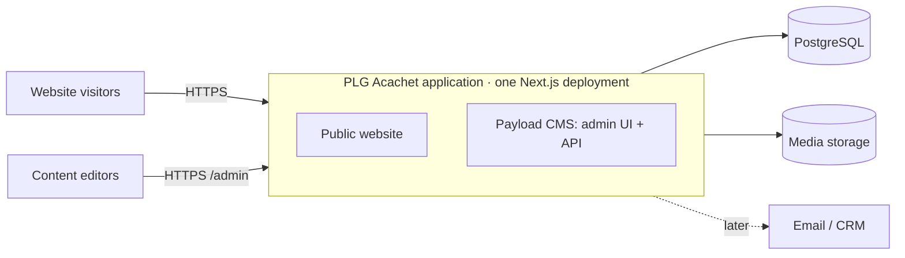
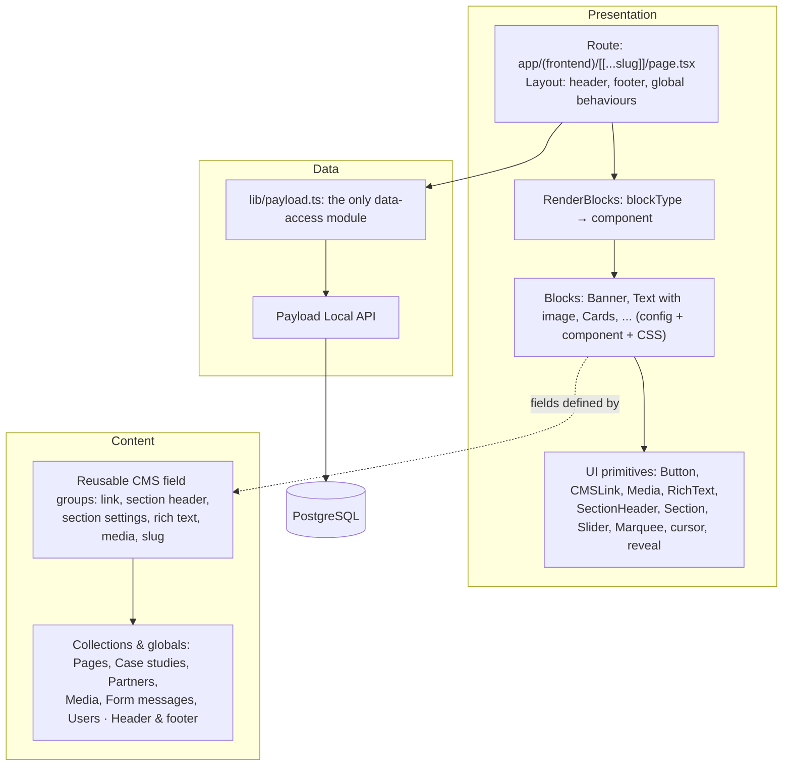
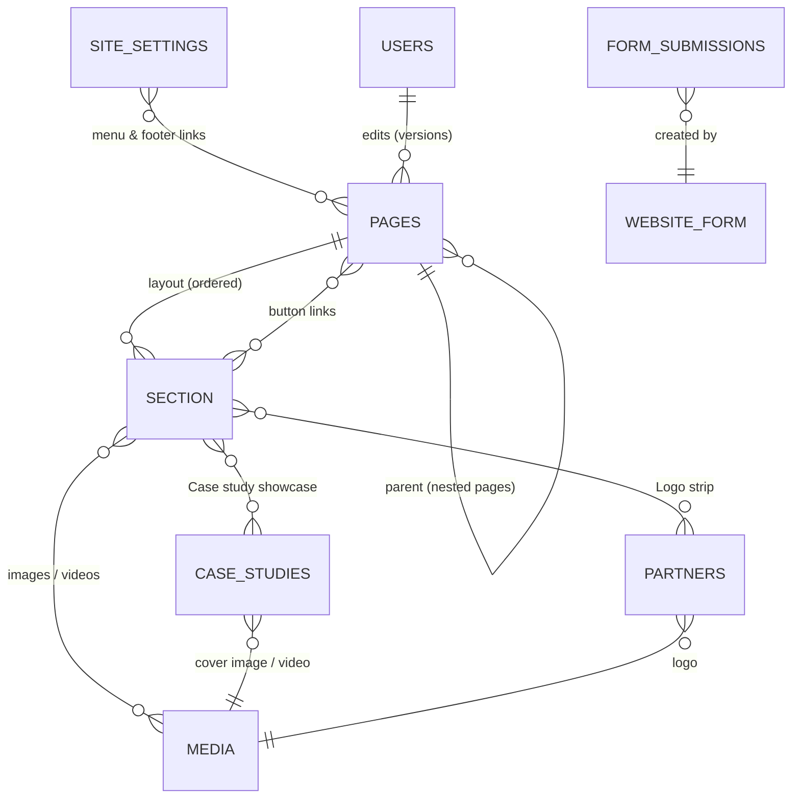
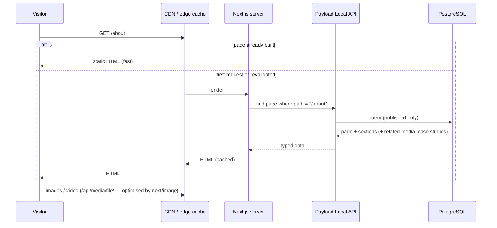
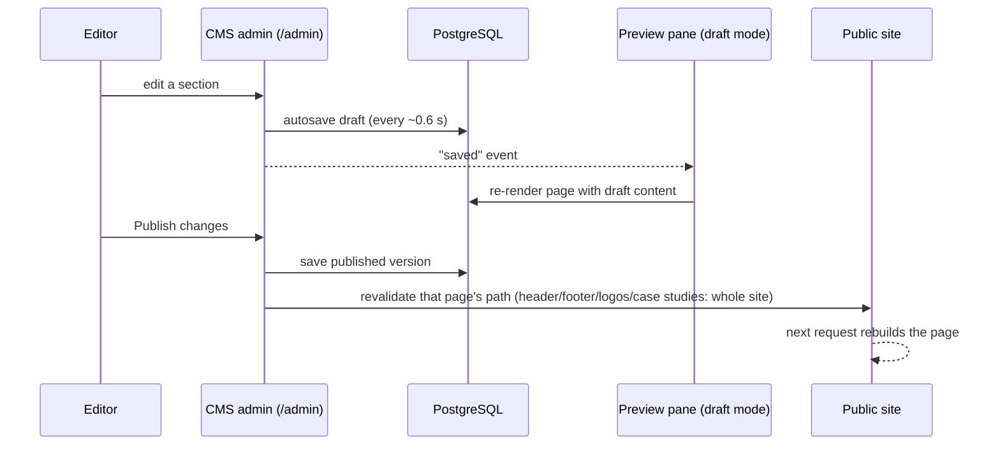
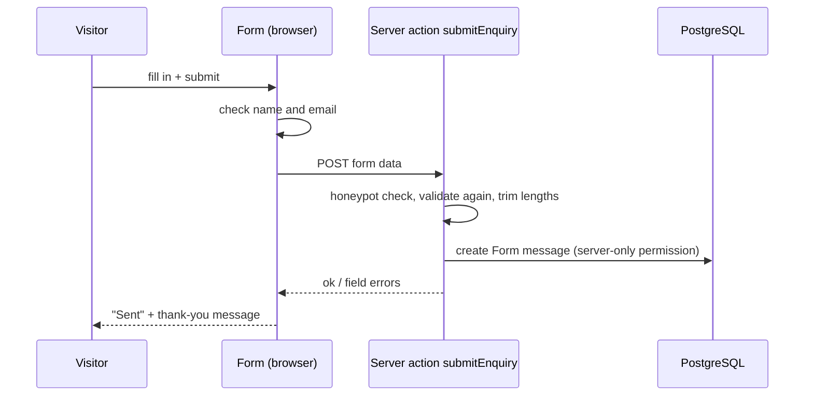
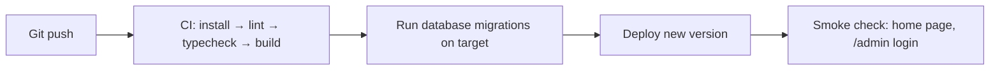
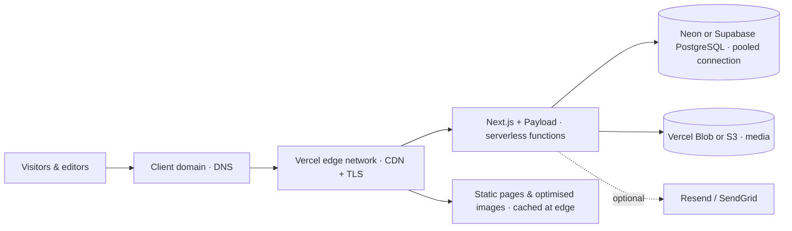
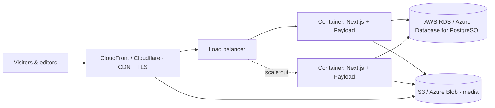

# PLG Acachet Website — Architecture

_Last updated: 13 November 2026 · Covers Phase 1, step 1 (foundation + Home page)_

This document describes **how the application is built** (Part A) and **how it is hosted** (Part B).
It contains no secrets and can be shared with the client. Diagrams use Mermaid (they render on GitHub, GitLab and most Markdown viewers).

- **Decided** = built and in use. **Proposed** = recommended, waiting for a client decision (mainly hosting).

---

# Part A — Application architecture

## A1. System context

The website and the CMS are **one application** (Next.js with Payload CMS embedded). There is no separate CMS server, no headless-CMS subscription and no extra network hop between them: the website reads content through Payload's in-process Local API.

## A2. Technology stack (decided)

| Layer | Choice | Version |
|---|---|---|
| Runtime | Node.js | 20.18+ (22 LTS recommended) |
| Web framework | Next.js, App Router, React Server Components | 16.4 |
| UI | React, TypeScript (strict), CSS Modules | React 19.2 |
| CMS | Payload CMS (admin UI, REST/GraphQL API, Local API) | 3.91 |
| Rich text | Lexical editor (restricted toolbar for editors) | via Payload |
| Database | PostgreSQL via `@payloadcms/db-postgres` (Drizzle) | PG 14+ |
| CMS plugins | Nested docs (page tree + breadcrumbs), SEO (meta tab) | 3.91 |
| Images | `next/image` + `sharp` (responsive WebP/AVIF) | |
| Live preview | `@payloadcms/live-preview-react` + Next.js draft mode | |

## A3. Layered structure

**Rules that keep it maintainable**
1. UI primitives know nothing about the CMS; blocks combine primitives; pages only list blocks.
2. Every block is assembled from the same field groups, so all sections edit the same way.
3. All database reads go through `src/lib/payload.ts`; components receive data as props.
4. New pages reuse blocks first, then add a variant to an existing block, and only then add a new block.

## A4. Source layout (`web/src`)

| Path | Responsibility |
|---|---|
| `app/(frontend)/` | Website: root layout, the single page route, form server action, preview routes, sitemap, 404 |
| `app/(payload)/` | Payload admin UI and REST/GraphQL API (generated) |
| `app/robots.ts` | robots.txt |
| `blocks/<Name>/` | One folder per section type: `config.ts` (CMS fields), `Component.tsx`, `Component.module.css` |
| `blocks/index.ts`, `blocks/RenderBlocks.tsx` | Block registry for the CMS and for rendering |
| `collections/`, `globals/` | Content model |
| `fields/` | Reusable CMS field groups |
| `access/` | Permission rules (admin / editor / public) |
| `components/layout/`, `components/ui/` | Header, footer, logo; UI primitives |
| `hooks/` | Shared scroll loop (`useRafScroll`), reduced-motion |
| `lib/` | Data access, link resolution, preview URL, revalidation, fixed routes |
| `styles/` | Global design tokens, reset, shared typography |
| `seed/` | Imports prototype content into the CMS |
| `migrations/` | Versioned database schema changes |
| `payload.config.ts`, `payload-types.ts` | CMS configuration; generated TypeScript types |

## A5. Content model

| Entity | Key fields | Notes |
|---|---|---|
| Pages | title, slug, parent, path (computed), layout (sections), meta (SEO) | Drafts, autosave, versions, scheduled publish |
| Section (block) | blockType + its fields + Section settings (anchorId, navLabel, theme, hideSection) | Stored inside the page |
| Case studies | title, slug, cardTitle, summary, client, image, video | Extended with full case study content in a later step |
| Partners | name, logo, height, mobileHeight, sortOrder | |
| Media | file, alt, focal point | Images, SVG, MP4/WebM |
| Form submissions | form, name, email, phone, message, page | Created only by the website |
| Users | email, password, name, role (admin / editor) | |
| Site settings (global) | headerLinks, mobileMenuNote, footerLinks, legalLinks, social, copyright | |

**Page addresses** are computed, not typed: `home` → `/`; other pages → their nested path (e.g. `/legal/terms`), stored in `path` and used for lookups.

## A6. Request lifecycle (public page)

- All published pages are generated at build time (`generateStaticParams`) and served as static HTML.
- Images are resized and converted per device by `next/image`; files come from media storage.

## A7. Editing and publishing lifecycle

- Preview opens `/next/preview?path=…&secret=…`, which turns on Next.js **draft mode** for that browser only. Visitors never see drafts.
- Draft mode can be turned off at `/next/exit-preview`.

## A8. Form submission flow

Later: notification email and CRM/careers-system hand-off from the same server action.

## A9. Rendering model

| Concern | Approach |
|---|---|
| Server vs client | Server components render markup; small client components add behaviour (menu, sliders, carousels, scroll effects, forms) |
| Scroll effects | One shared, frame-batched scroll loop (`useRafScroll`): all layout reads, then all style writes, at most once per frame |
| Reveal on scroll | One global observer adds `.in` to elements marked `data-reveal` |
| Styling | Global tokens + shared typography; everything else in per-component CSS Modules |
| Header tone | Sections with white backgrounds mark themselves `data-nav-tone="light"`; the header reads that while scrolling |
| Accessibility | Reduced-motion respected everywhere; keyboard menu; labelled controls |

## A10. Security model

| Area | Measure |
|---|---|
| Authentication | Payload auth (hashed passwords, signed sessions via `PAYLOAD_SECRET`) |
| Authorisation | Admin: everything. Editor: content only. Public: published pages and media only |
| Drafts | Readable only by signed-in users; preview route protected by `PREVIEW_SECRET` |
| Form messages | API create/update disabled; only the server action can create them |
| Secrets | Environment variables only; `.env` never committed |
| Indexing | `/admin`, `/api`, `/next` disallowed in robots.txt |

## A11. Build and release pipeline

| Command | Purpose |
|---|---|
| `npm run lint`, `npm run typecheck`, `npm run build` | Quality gates |
| `npm run migrate:create -- <name>` | Generate a migration after a schema change (committed to git) |
| `npm run migrate` | Apply migrations to a database |
| `npm run seed` | Load prototype content (development / first setup only) |
| `npm run generate:types` | Regenerate TypeScript types from the CMS config |

---

# Part B — Server architecture

## B1. Hosting requirements

The application is a **Node.js server** (not a static export): the CMS admin, API, form handling, preview and on-demand page rebuilds all need a running server.

| Component | Requirement |
|---|---|
| Application | Node.js 20.18+ (22 LTS), ~1 GB RAM minimum per instance, 1–2 vCPU |
| Database | PostgreSQL 14+, managed, with automated backups and point-in-time recovery |
| Media storage | Object storage (S3-compatible or Vercel Blob). Required on serverless or multi-instance hosting, where local disk is temporary or not shared |
| CDN | In front of the site and media (included with Vercel; CloudFront / Cloudflare otherwise) |
| TLS | HTTPS on the client's domain |
| Email (optional) | Transactional email provider for password resets and form notifications |

## B2. Environments

| Environment | Purpose | Database | Media | Status |
|---|---|---|---|---|
| Local development | Building and testing | Embedded PostgreSQL started by `npm run db` (port 5433, data in `web/.postgres`) | Local `web/media/` folder | **Decided, in use** |
| Staging | Client review of each step | Managed PostgreSQL (separate database) | Bucket / prefix for staging | Proposed |
| Production | Live website | Managed PostgreSQL | Production bucket + CDN | Proposed |

Each environment has its own database, media storage and secrets. Content is entered in production once live; staging can be refreshed from a production backup.

## B3. Recommended topology — Option A: managed platform (proposed, recommended)

- **Pros:** least operations work; automatic HTTPS, CDN, preview deployments per branch; scales automatically.
- **Needs:** pooled database connection string (serverless opens many short connections); media storage adapter (`@payloadcms/storage-vercel-blob` or `@payloadcms/storage-s3`) added before go-live.
- **Typical running cost:** low tens of USD/month at this traffic level (platform + database + storage), depending on plans.

## B4. Alternative topology — Option B: cloud container (proposed)

- Suits a client that requires its own AWS/Azure account or a UAE region.
- Runs as a Docker container on ECS/Fargate, Azure Container Apps, App Runner or a VM.
- More operations work (patching, scaling rules, monitoring) than Option A.
- Simplest form: one container + managed database + bucket; add instances behind the load balancer when needed (media must then be in the bucket, which it is).

## B5. Data and media

| Concern | Approach |
|---|---|
| Schema changes | Versioned migrations in `web/src/migrations`, applied before each release |
| Connections | Pooled connections (PgBouncer / provider pooler) on serverless |
| Media | Uploaded through the CMS; stored in object storage; served through the CDN and resized by `next/image` |
| Backups | Daily automated database backups with point-in-time recovery (7–30 days); bucket versioning for media |
| Restore drill | Restore a backup into staging before go-live to prove the process |

## B6. Caching and performance

| Layer | What is cached | Invalidated by |
|---|---|---|
| CDN / edge | Static page HTML, optimised images, static assets | Deploys; on-demand revalidation |
| Next.js | Pre-rendered pages (all published pages built at deploy) | `revalidatePath` on publish (one page) or on header/footer/logos/case-study changes (whole site) |
| Browser | Hashed static assets (long-lived) | New deploy (new file names) |

## B7. Security (infrastructure)

- HTTPS everywhere; HSTS on the domain.
- Database not publicly reachable where the platform allows (private networking / IP allow-list); TLS connections.
- Secrets in the platform's secret store, separate per environment, rotated on handover.
- Optional: restrict `/admin` by IP or SSO for the client's team; Web Application Firewall rules at the CDN.
- Dependency updates and security patches applied on a regular schedule.

## B8. Monitoring and operations

| Need | Suggested tool |
|---|---|
| Uptime | Platform monitoring or an uptime service (e.g. Better Stack, UptimeRobot) on `/` and `/admin` |
| Errors | Platform logs; optional Sentry for front- and back-end errors |
| Performance | Vercel Analytics / Speed Insights or Lighthouse checks in CI |
| Database | Provider dashboard: connections, storage, slow queries |

## B9. Configuration (per environment)

| Variable | Purpose |
|---|---|
| `DATABASE_URL` | PostgreSQL connection string (pooled on serverless) |
| `PAYLOAD_SECRET` | Signs CMS sessions |
| `NEXT_PUBLIC_SITE_URL` | Public site address (share images, sitemap, preview) |
| `PREVIEW_SECRET` | Protects the preview route |
| Storage credentials | Added with the media storage adapter (bucket name, region, keys or token) |
| Email credentials | Added with the email adapter |

## B10. Decisions

| Area | Decision | Status |
|---|---|---|
| Application | Next.js + Payload in one deployment | Decided |
| Database engine | PostgreSQL | Decided |
| Local database | Embedded PostgreSQL (no install needed) | Decided |
| Page model | Pages made of reorderable, configurable sections | Decided |
| Hosting platform | Option A (Vercel + Neon/Supabase + Blob/S3) or Option B (AWS/Azure container) | **Client decision needed** |
| Region | Closest to the audience (e.g. Middle East / Europe) | **Client decision needed** |
| Media storage | Vercel Blob or S3-compatible bucket | Follows hosting decision |
| Email provider | Resend / SendGrid / AWS SES | **Client decision needed** |
| Form destinations | CMS inbox now; email/CRM later | **Client decision needed** |
| Cookie consent & analytics | Platform to be chosen | **Client decision needed** |
