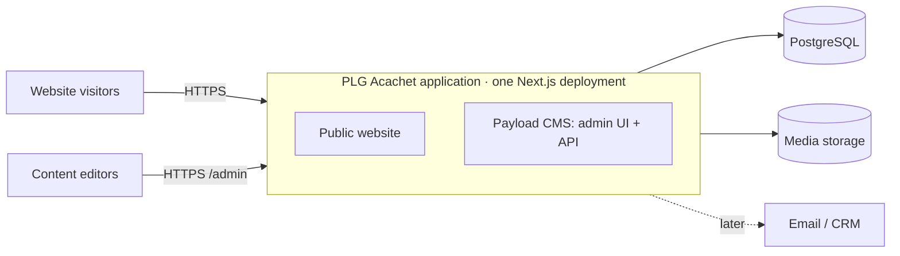
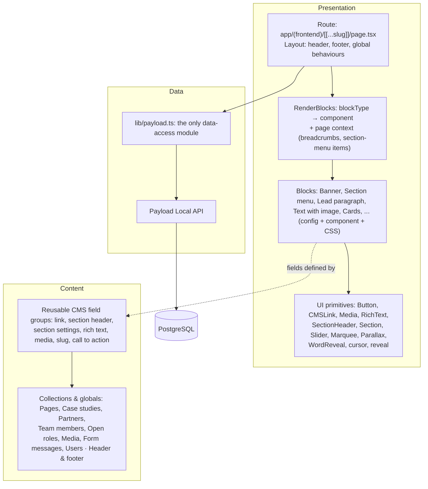
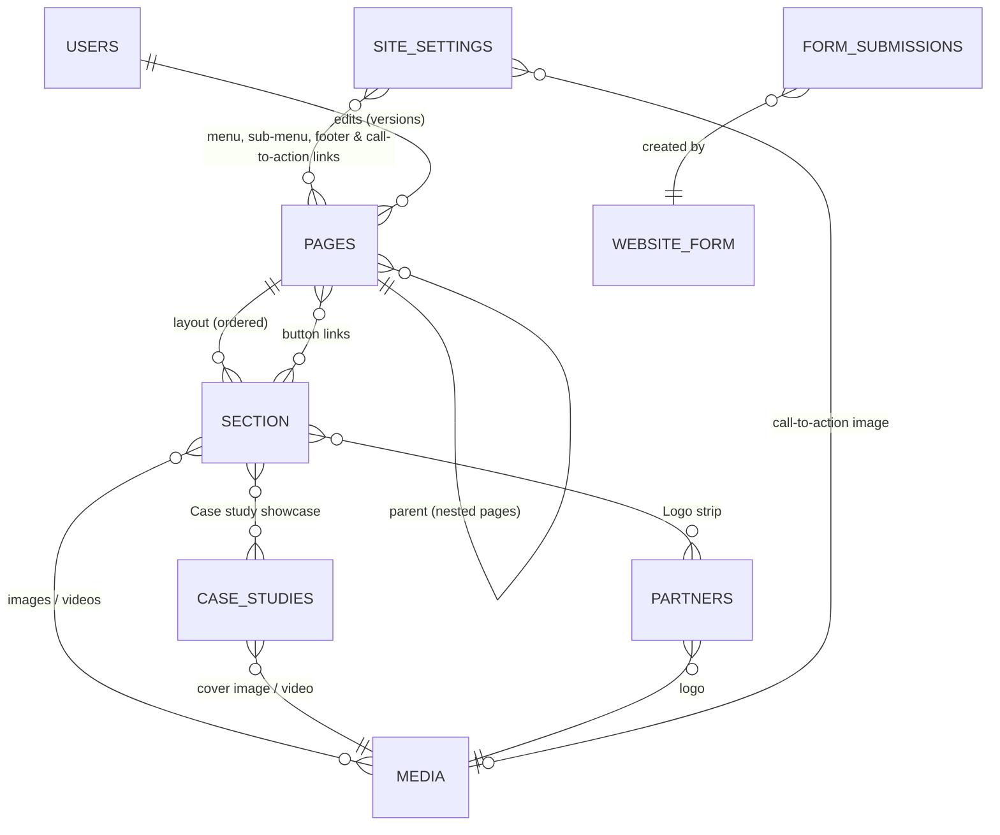
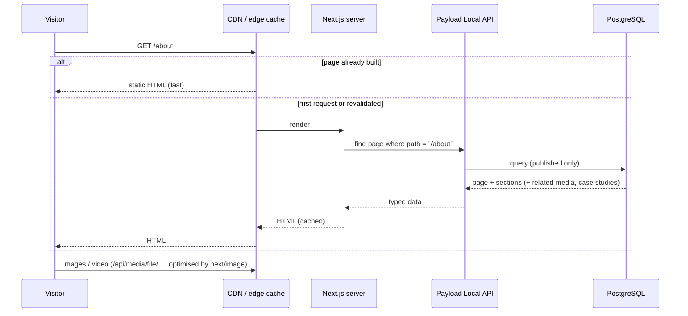
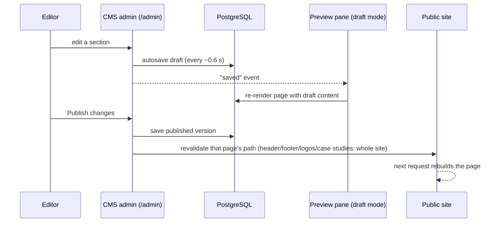
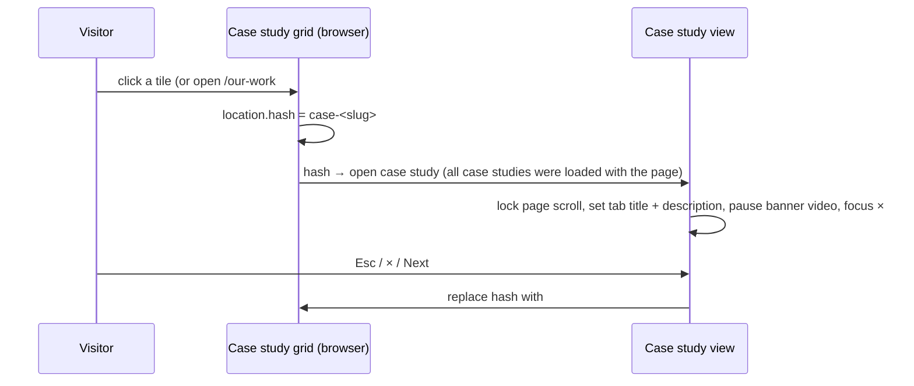
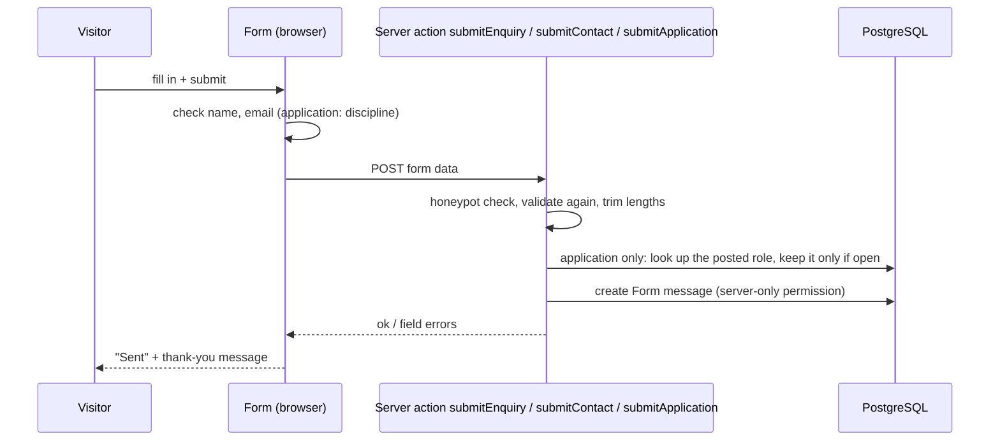
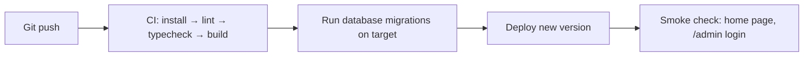
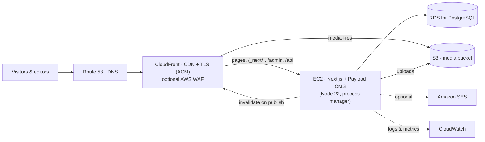

# PLG Acachet Website — Architecture

_Last updated: 16 November 2026 · Covers Phase 1, steps 1–8 (foundation, Home, About, Our Story, The Team, Join Us, Services, Our Work and Contact pages) and the proposed AWS production setup_

This document describes **how the application is built** (Part A) and **how it is hosted** (Part B).
It contains no secrets and can be shared with the client. Diagrams use Mermaid (they render on GitHub, GitLab and most Markdown viewers).

- **Decided** = built and in use. **Proposed** = recommended, waiting for a client decision (mainly hosting).

---

# Part A — Application architecture

## A1. System context

The website and the CMS are **one application** (Next.js with Payload CMS embedded). There is no separate CMS server, no headless-CMS subscription and no extra network hop between them: the website reads content through Payload's in-process Local API.

## A2. Technology stack (decided)

| Layer | Choice | Version |
|---|---|---|
| Runtime | Node.js | 20.18+ (22 LTS recommended) |
| Web framework | Next.js, App Router, React Server Components | 16.4 |
| UI | React, TypeScript (strict), CSS Modules | React 19.2 |
| CMS | Payload CMS (admin UI, REST/GraphQL API, Local API) | 3.91 |
| Rich text | Lexical editor (restricted toolbar for editors) | via Payload |
| Database | PostgreSQL via `@payloadcms/db-postgres` (Drizzle) | PG 14+ |
| CMS plugins | Nested docs (page tree + breadcrumbs), SEO (meta tab) | 3.91 |
| Images | `next/image` + `sharp` (responsive WebP/AVIF) | |
| Live preview | `@payloadcms/live-preview-react` + Next.js draft mode | |
| Media storage | `@payloadcms/storage-s3` (Amazon S3), local disk when not configured | 3.91 |
| CDN refresh | `@aws-sdk/client-cloudfront` (invalidation on publish) | |
| Email | `@payloadcms/email-nodemailer` (SMTP, e.g. Amazon SES) | 3.91 |

## A3. Layered structure

**Rules that keep it maintainable**
1. UI primitives know nothing about the CMS; blocks combine primitives; pages only list blocks.
2. Every block is assembled from the same field groups, so all sections edit the same way.
3. All database reads go through `src/lib/payload.ts`; components receive data as props.
4. New pages reuse blocks first, then add a variant to an existing block, and only then add a new block.

## A4. Source layout (`web/src`)

| Path | Responsibility |
|---|---|
| `app/(frontend)/` | Website: root layout, the single page route, form server action, preview routes, sitemap, 404 |
| `app/(payload)/` | Payload admin UI and REST/GraphQL API (generated) |
| `app/robots.ts` | robots.txt |
| `blocks/<Name>/` | One folder per section type: `config.ts` (CMS fields), `Component.tsx`, `Component.module.css` |
| `blocks/index.ts`, `blocks/RenderBlocks.tsx` | Block registry for the CMS and for rendering |
| `blocks/context.ts` | Page context handed to every block (page title/path/breadcrumbs, section-menu items derived from the sections) |
| `collections/`, `globals/` | Content model |
| `fields/` | Reusable CMS field groups |
| `access/` | Permission rules (admin / editor / public) |
| `components/layout/`, `components/ui/` | Header, footer, logo; UI primitives |
| `hooks/` | Shared scroll loop (`useRafScroll`), reduced-motion |
| `lib/` | Data access, link resolution, preview URL, revalidation, fixed routes |
| `styles/` | Global design tokens, reset, shared typography |
| `seed/` | Imports prototype content into the CMS |
| `migrations/` | Versioned database schema changes |
| `payload.config.ts`, `payload-types.ts` | CMS configuration; generated TypeScript types |

## A5. Content model

| Entity | Key fields | Notes |
|---|---|---|
| Pages | title, slug, parent, path (computed), layout (sections), meta (SEO) | Drafts, autosave, versions, scheduled publish |
| Section (block) | blockType + its fields + Section settings (anchorId, navLabel, theme, hideSection) | Stored inside the page |
| Case studies | title, slug, cardTitle, summary, client, services[], image, video, wide, keyVisualPending, market, year, brief, approach, results[], points[], gallery[], still, film, captions, metaDescription, sortOrder | Tiles (Home, Our Work) and the full case study at `/our-work#case-<slug>`; `[brackets]` = to be confirmed |
| Partners | name, logo, height, mobileHeight, sortOrder | |
| Team members | name, jobTitle, photo, group (management / creative / staff), department (top / commercial / delivery / operations), headOfDepartment, accountOwner, bio, linkedin, instagram, x, sortOrder | The Team page directory; org chart derived from department + head |
| Open roles | title, team (commercial / delivery / creative / analytics), location, employmentType, summary, points[], isOpen, sortOrder | Join Us "Open roles" list and the application form's role list (only `isOpen`) |
| Media | file, alt, focal point | Images, SVG, MP4/WebM |
| Form submissions | form (enquiry / application), name, email, phone, company, interests, consent, role, discipline, profileLink, message, page | Created only by the website. Application fields shown only for job applications. No CV file yet: the form shows the CV field, but the file is not sent (backlog) |
| Users | email, password, name, role (admin / editor) | |
| Site settings (global) | headerLinks (+ subLinks for the mobile menu), mobileMenuNote, cta (site-wide call to action), footerLinks, legalLinks, social, copyright | |

**Page addresses** are computed, not typed: `home` → `/`; other pages → their nested path (e.g. `/about/our-story`, `/legal/terms`), stored in `path` and used for lookups. Our Story, The Team and Join Us are children of About.

**Derived, never typed by editors:** breadcrumbs (from the nested-docs page tree), section-menu links (from each section's Section ID + "Name in section menu", or from the main menu's sub-links for the group containing the page, plus a "Back to <parent>" link), card numbers (from order), the Team org chart (from each member's position and column head) and filter options with counts (from member groups), the Join Us role filter buttons with counts (from each role's team), service numbers ("02 / 04") and alternating bands (from the order of Service detail sections), the current-page highlight in the header (from the URL).

**Sections available (step 8):** Banner (`hero`: showreel / page, with headline size, larger/smaller-on-phones + photo style options), Section menu (`sectionNav`: sections / menu; bar / sticky numbered), Lead paragraph (`leadText`: text size, orange words tail / particular words / phrase, diagrams "merge", "weave" and "cross", details row with labelled list, heading, notes, grey band, closing line), Text with image (`mediaText`: fade / card), Cards (`cardCarousel`: service / pillar), Stacking panels, Side-by-side statements (`statements`), Text over image (`backgroundText`), Key numbers, Logo strip (optional label → slim look), Case study showcase (optional per-tile photo), Case study grid (`caseStudyGrid`: sticky filter, tiles, full case study view by URL hash), Group structure (`ownership`), Team directory (`teamDirectory`: reads Team members; grid / org chart, filter, profile panel), Group chain (`groupScale`), Open roles (`openRoles`: reads Open roles; team filter, expandable rows, "Apply" prefills the form), Statement (centered / band), Link tiles (`linkTiles`: standard / tall / numbered), Service detail (`serviceDetail`: nested content pieces photo / highlight / list / collage; number and band from position), Call to action banner (`ctaBanner`, site-wide default in Site settings with per-page override), Form (enquiry / detailed enquiry / application), Office (`offices`: photo, live local time, contact rows with copy / directions).

## A6. Request lifecycle (public page)

- All published pages are generated at build time (`generateStaticParams`) and served as static HTML.
- Images are resized and converted per device by `next/image`; files come from media storage.

## A7. Editing and publishing lifecycle

- Preview opens `/next/preview?path=…&secret=…`, which turns on Next.js **draft mode** for that browser only. Visitors never see drafts.
- Draft mode can be turned off at `/next/exit-preview`.

## A7b. Case study view (Our Work)

All case study content is part of the statically built Our Work page, so opening one needs no server request.

## A8. Form submission flow

On Join Us, "Apply for this role" in the Open roles section sends a browser event that the application form listens for; it selects that role and its discipline and the link scrolls to the form.

**CV upload is deferred** (`docs/backlog-cv-upload.md`): the form already shows the CV field, but the file is not sent. When added, CVs go to a private S3 bucket/prefix through an access-controlled Payload upload collection, never the public media bucket or CloudFront.

Later: notification email and CRM/careers-system hand-off from the same server actions.

## A9. Rendering model

| Concern | Approach |
|---|---|
| Server vs client | Server components render markup; small client components add behaviour (menu, sliders, carousels, scroll effects, forms) |
| Scroll effects | One shared, frame-batched scroll loop (`useRafScroll`): all layout reads, then all style writes, at most once per frame |
| Reveal on scroll | One global observer adds `.in` to elements marked `data-reveal` (fade/slide in) or `data-inview` (no styling; blocks start their own animations, e.g. diagram lines, report bars, nested frames) |
| Page context | `RenderBlocks` passes each block the page (title, path, breadcrumbs) and the section-menu items, so the Banner breadcrumb and the Section menu need no editor input |
| Styling | Global tokens + shared typography; everything else in per-component CSS Modules |
| Header tone | Sections with white backgrounds mark themselves `data-nav-tone="light"`; the header reads that while scrolling |
| Accessibility | Reduced-motion respected everywhere; keyboard menu; labelled controls |

## A10. Security model

| Area | Measure |
|---|---|
| Authentication | Payload auth (hashed passwords, signed sessions via `PAYLOAD_SECRET`) |
| Authorisation | Admin: everything. Editor: content only. Public: published pages and media only |
| Drafts | Readable only by signed-in users; preview route protected by `PREVIEW_SECRET` |
| Form messages | API create/update disabled; only the server action can create them |
| Secrets | Environment variables only; `.env` never committed |
| Indexing | `/admin`, `/api`, `/next` disallowed in robots.txt |

## A11. Build and release pipeline

| Command | Purpose |
|---|---|
| `npm run lint`, `npm run typecheck`, `npm run build` | Quality gates |
| `npm run migrate:create -- <name>` | Generate a migration after a schema change (committed to git) |
| `npm run migrate` | Apply migrations to a database |
| `npm run seed` | Load prototype content (development / first setup only) |
| `npm run generate:types` | Regenerate TypeScript types from the CMS config |

---

# Part B — Server architecture

The production plan is the **AWS Middle East (UAE) architecture** in [`hosting-architecture.md`](hosting-architecture.md) (prepared 12 November 2026). Development proceeds on that basis. It may change later, so every external service is connected through environment variables and can be swapped without code changes (section B9).

## B1. Hosting requirements

The application is a **long-running Node.js server** (not a static export): the CMS admin, API, form handling, preview and on-demand page rebuilds need a running server. That fits Amazon EC2.

| Component | Requirement |
|---|---|
| Application | Node.js 20.18+ (22 LTS), 2 GB RAM recommended (image resizing and the CMS admin build), 2 vCPU |
| Database | PostgreSQL 14+, managed (Amazon RDS), automated backups and point-in-time recovery |
| Media storage | Amazon S3 bucket (application uses it when `S3_BUCKET` is set) |
| CDN | Amazon CloudFront in front of the site and the media bucket |
| TLS | AWS Certificate Manager certificate on the client's domain |
| Email (optional) | Amazon SES (SMTP) or any SMTP service, for password resets and form notifications |

## B2. Environments

| Environment | Purpose | Database | Media | Status |
|---|---|---|---|---|
| Local development | Building and testing | Embedded PostgreSQL started by `npm run db` (port 5433, data in `web/.postgres`) | Local `web/media/` folder | **In use** |
| Staging | Client review of each step | RDS PostgreSQL (separate database or small instance) | Separate S3 bucket or prefix | Planned (same AWS setup, smaller sizes) |
| Production | Live website | RDS PostgreSQL | S3 bucket + CloudFront | Planned |

Each environment has its own database, bucket and secrets. Once live, content is entered in production; staging can be refreshed from a production snapshot.

## B3. Production topology (AWS me-central-1)

| # | Component | AWS service | Role in this application |
|---|---|---|---|
| 1 | DNS | Route 53 | Domain → CloudFront |
| 2 | Certificate | ACM | HTTPS on the domain (certificate for CloudFront is issued in us-east-1, as CloudFront requires) |
| 3 | CDN | CloudFront | Caches pages, images and videos at edge locations including the UAE |
| 4 | Application | EC2 | Runs `next start` (website + CMS) |
| 5 | Database | RDS for PostgreSQL | All CMS content, users, form messages |
| 6 | Media | S3 | Every upload from the CMS |
| 7 | Firewall (optional) | WAF | Bot and common-attack protection on CloudFront |
| 8 | Monitoring | CloudWatch | Logs, metrics, alarms, health check on `/next/health` |

### CloudFront behaviours (recommended)

| Path | Origin | Caching |
|---|---|---|
| `/_next/static/*` | EC2 | Cache long (files are content-hashed) |
| `/_next/image*` | EC2 | Cache, include query string in the cache key |
| `/admin*`, `/api/*`, `/next/*` | EC2 | **No caching**; forward cookies, headers and query strings |
| Media path (e.g. `media.<domain>/*` or `/media/*`) | S3 (Origin Access Control) | Cache long |
| Default (`/*`, pages) | EC2 | Cache using the origin's headers; forward the draft-mode cookie so previews bypass the cache |

When an editor publishes, the application clears the changed page from both Next.js's cache and CloudFront (`CreateInvalidation`; whole site for header/footer, logo or case-study changes).

## B4. How images and videos are delivered

| Media | Delivery |
|---|---|
| Images | Uploaded to S3. `next/image` serves each device a resized AVIF/WebP version; those versions are cached on the server and at CloudFront |
| Background videos | Optimised MP4 files in S3, delivered through CloudFront. The banner supports a separate lighter **mobile video** (≤900px) and shows the poster image instantly |
| Logos (SVG) | Served as-is from S3 via CloudFront |
| Long videos with a player | Not needed at launch. If required later, add Bunny Stream or AWS MediaConvert; the rest of the architecture stays the same |

## B5. Data, backups and migrations

| Concern | Approach |
|---|---|
| Schema changes | Versioned migrations in `web/src/migrations`, applied with `npm run migrate` before each release |
| Database access | RDS in a private subnet, reachable only from the EC2 security group; TLS connections (`?sslmode=require` in `DATABASE_URL`) |
| Backups | RDS automated daily backups with point-in-time recovery (7–35 days); snapshot before each release |
| Media | S3 versioning on; bucket private, read through CloudFront Origin Access Control |
| Restore drill | Restore an RDS snapshot to staging before go-live |

## B6. Caching layers

| Layer | What | Cleared by |
|---|---|---|
| CloudFront | Page HTML, `/_next/*` assets, optimised images, media files | Publish (automatic invalidation); deploys for assets (new file names) |
| Next.js server | Pre-rendered pages (all published pages built at deploy) and optimised images | `revalidatePath` on publish |
| Browser | Content-hashed assets | New deploy |

## B7. Security

- HTTPS only (CloudFront redirect), HSTS on the domain.
- EC2 accepts web traffic only from CloudFront (CloudFront managed prefix list in the security group); SSH via AWS Systems Manager Session Manager instead of an open port.
- RDS private, TLS; S3 private with Origin Access Control.
- EC2 IAM role with least privilege: `s3:GetObject/PutObject/DeleteObject/ListBucket` on the media bucket, `cloudfront:CreateInvalidation` on the distribution, CloudWatch logs.
- Secrets (`PAYLOAD_SECRET`, `DATABASE_URL`, `PREVIEW_SECRET`, SMTP) in AWS Secrets Manager or SSM Parameter Store, loaded into the process environment.
- Optional AWS WAF managed rules (bot control, common attacks, rate limiting on `/admin` and `/api`).

## B8. Monitoring and operations

| Need | Approach |
|---|---|
| Uptime | CloudWatch Synthetics canary or Route 53 health check on `/next/health` (returns 200 when app and database are reachable) |
| Logs | Application stdout/stderr shipped to CloudWatch Logs (CloudWatch agent) |
| Alarms | EC2 CPU/memory/disk, RDS CPU/connections/storage, CloudFront 5xx rate, health check failures |
| Process | Node process kept alive by a process manager (systemd or PM2) or run as a Docker container; restarts on failure and on reboot |

## B9. Configuration (environment variables)

Integrations switch on when their variables are set, so the same code runs locally (all off) and on AWS (all on). Full list with comments: `web/.env.example`.

| Variable | Purpose | Production value (example) |
|---|---|---|
| `DATABASE_URL` | PostgreSQL connection | RDS endpoint, `?sslmode=require` |
| `PAYLOAD_SECRET` | Signs CMS sessions | long random string |
| `NEXT_PUBLIC_SITE_URL` | Public site address | `https://www.<domain>` |
| `PREVIEW_SECRET` | Protects the preview route | long random string |
| `S3_BUCKET`, `S3_REGION`, `S3_PREFIX` | Media storage on S3 (unset = local disk) | bucket name, `me-central-1`, `media` |
| `S3_ACCESS_KEY_ID`, `S3_SECRET_ACCESS_KEY` | Only outside AWS (EC2 uses its IAM role) | — |
| `S3_ENDPOINT` | Only for S3-compatible services other than AWS | — |
| `MEDIA_PUBLIC_URL` | Media URLs point at the CDN instead of the app | `https://media.<domain>` |
| `CLOUDFRONT_DISTRIBUTION_ID` | Clear CDN cache on publish | distribution ID |
| `SMTP_HOST`, `SMTP_PORT`, `SMTP_USER`, `SMTP_PASS`, `EMAIL_FROM_ADDRESS`, `EMAIL_FROM_NAME` | Outgoing email (unset = printed to console) | SES SMTP endpoint in me-central-1 |

Code locations: `web/src/integrations/storage.ts` (S3), `cdn.ts` (CloudFront), `email.ts` (SMTP).

## B10. Deployment on EC2 (outline)

1. Provision RDS, the S3 bucket, CloudFront distribution (behaviours as in B3), ACM certificate, Route 53 records and the EC2 instance with its IAM role.
2. On the instance: install Node.js 22 LTS; check out the release; `npm ci`.
3. Provide environment variables (Secrets Manager / Parameter Store → environment).
4. `npm run migrate` (applies pending database migrations).
5. `npm run build`, then run `npm run start` under systemd or PM2 (port 3000, behind CloudFront).
6. Check `/next/health`, the home page and `/admin` sign-in; invalidate CloudFront `/*` after the first deploy.
7. First content: run `npm run seed` once against the production database with S3 enabled (uploads go straight to S3), then change the seeded passwords; or enter content in the CMS.

A CI pipeline (e.g. GitHub Actions) can run lint, typecheck and build, then deploy to EC2 via AWS Systems Manager or CodeDeploy.

## B11. Decisions

| Area | Decision | Status |
|---|---|---|
| Application | Next.js + Payload in one deployment | Decided |
| Database engine | PostgreSQL | Decided |
| Local database | Embedded PostgreSQL (no install needed) | Decided |
| Page model | Pages made of reorderable, configurable sections | Decided |
| About sub-pages | Our Story, The Team, Join Us nested under About (`/about/our-story` …), matching the prototype breadcrumb "Home / About Us / Our Story" | Decided (step 2) |
| Call to action | One site-wide "Start a conversation" banner in Header & footer; pages can override | Decided (step 2) |
| Inner-page look | The look shared by every inner prototype page is the default; About's differences (brighter banner photo, fitted headline, tall tiles on black) are options | Decided (step 3) |
| Section menu on About sub-pages | Copies the main menu's About sub-links (one place to edit) | Decided (step 3) |
| Team members | A shared collection (not fields inside the page), so people are edited once and the org chart / filter are derived from each person's group and position | Decided (step 4) |
| Open roles | A shared collection with a "show on the website" switch, read by the Open roles section and the application form | Decided (step 5) |
| CV upload | Deferred until the client confirms retention, access, consent and ATS, and a private S3 bucket is available | **Client decision needed** (step 5) |
| Cloud & region | AWS, Middle East (UAE) `me-central-1` | **Proposed, development proceeds on it** |
| Server | EC2 running Next.js + Payload | Proposed |
| Database service | RDS for PostgreSQL | Proposed |
| Media | S3 + CloudFront; S3 adapter built in, switched on by `S3_BUCKET` | Proposed; code ready |
| CDN refresh | CloudFront invalidation on publish, switched on by `CLOUDFRONT_DISTRIBUTION_ID` | Proposed; code ready |
| Video | Plain MP4 on S3/CloudFront, optional lighter mobile video; no streaming service at launch | Proposed; code ready |
| Firewall | AWS WAF | Optional |
| Monitoring | CloudWatch, health check `/next/health` | Proposed; endpoint ready |
| Email | Amazon SES (SMTP adapter built in, switched on by `SMTP_HOST`) | Client decision needed; code ready |
| Server sizing & cost | Depends on expected monthly visitors | **Client input needed** |
| Form destinations | CMS inbox now; email/CRM later | Client decision needed |
| Cookie consent & analytics | Platform to be chosen | Client decision needed |
